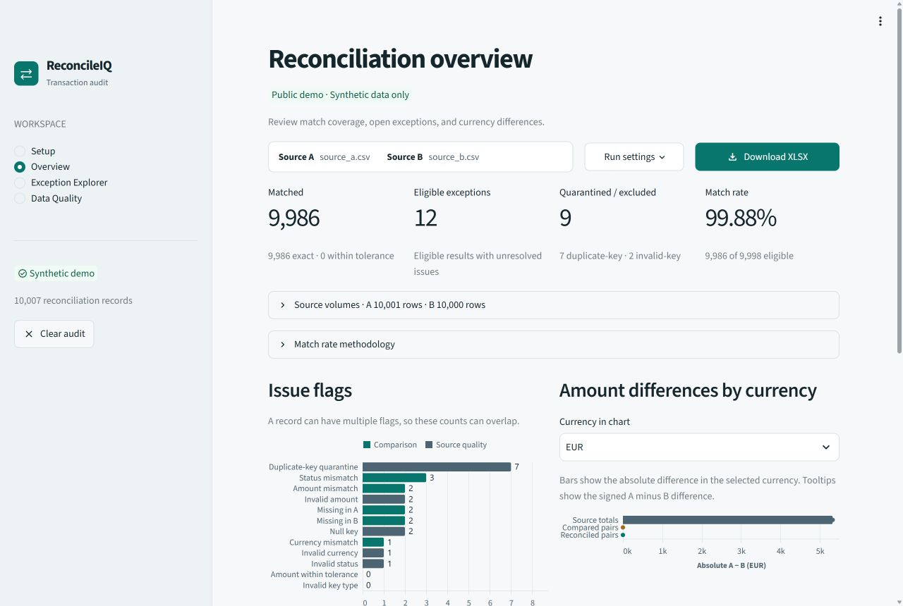

# ReconcileIQ

ReconcileIQ compares two transaction sources, explains differences, and produces an Excel audit report with a trace back to the original rows. It is a self-directed portfolio project for financial operations and data quality. All bundled records, examples, and screenshots use synthetic data.

**[🚀 Try the Live Demo](https://reconcileiq-demo.streamlit.app/)**

Explore the interactive reconciliation dashboard, investigate synthetic transaction discrepancies, and review downloadable Excel audit reports. No installation required.

The public demo uses synthetic data and disables file uploads.



[Exception Explorer](docs/screenshots/phase4-explorer.jpg) · [Excel audit report](docs/screenshots/phase4-excel-report.jpg) · [Case study](docs/case_study.md) · [Upwork portfolio materials](docs/upwork_portfolio.md)

## Run locally

Use Python 3.12 and run these commands from the repository root. Activate the virtual environment with `source .venv/bin/activate` on macOS or Linux.

```powershell
python -m venv .venv
.venv\Scripts\Activate.ps1
python -m pip install -r requirements.txt
```

Run the public demo locally:

```powershell
python -m streamlit run demo_app.py --server.address 127.0.0.1
```

Open the localhost URL printed by Streamlit and select **Load demo dataset**. The demo entry point uses only the bundled synthetic sources and disables file uploads. It supports all review screens and an Excel download. [Streamlit Community Cloud deployment guide](docs/deployment.md)

For local use with your own files, stop the server and run the private workspace with uploads enabled:

```powershell
python -m streamlit run app.py --server.address 127.0.0.1 --server.maxUploadSize 15
```

The shared server configuration disables uploads until you set a positive upload limit for the private workspace. In **Setup**, upload two CSV or XLSX files. Choose a worksheet for each Excel file, map key columns in matching order, review the amount, currency, and status mappings, and set an optional amount tolerance. The default tolerance is zero.

## Explore an audit

| View | What to look for |
| --- | --- |
| Overview | See exact and tolerated matches, eligible exceptions, quarantined records, and the match-rate denominator. Compare source, compared, and reconciled totals in each currency. |
| Exception Explorer | Filter by primary classification, flags, or currency. Select a row to see the original values and comparison rules. A duplicate opens its full group, including rows outside the active filters. |
| Data Quality | Compare source-row issue counts, required-value gaps, and exclusions. A duplicate group can include a unique counterpart that the audit quarantined. |
| Download XLSX | Export seven sheets covering the executive summary, reconciliation results, exceptions, duplicate keys, data quality, currency totals, and audit configuration. |

The bundled demo produces **10,007 result records** from **20,001 source rows**. The match rate is **99.88%**, with **9,986 exact matches** out of **9,998 eligible records**, alongside **12 eligible exceptions** and **9 quarantined records**. The source generator introduces 14 scenarios and records the expected outcomes in the [ground-truth manifest](data/demo/ground_truth.json).

## Architecture

| Component | Responsibility |
| --- | --- |
| `app.py`, `demo_app.py`, and `reconcileiq_ui/` | Shared Streamlit workspace with separate entry points for local uploads and the synthetic-only demo |
| `src/reconcileiq/inputs.py` and `config.py` | CSV and XLSX parsing, source-row references, column mappings, and comparison configuration |
| `src/reconcileiq/engine.py` | DuckDB grouping of normalized keys and `Decimal` comparisons of valid amounts within the same currency |
| `src/reconcileiq/audit.py`, `audit_workbook.py`, and `export.py` | Shared audit metrics, formatted Excel workbooks, and JSON and CSV reports |
| `data/demo/` and `scripts/` | Bundled synthetic sources, anomaly manifest, reproducible data generator, and independent verifier |

The Streamlit workspace, CLI, and Python API call the same reconciliation engine. Each source row is represented once in the audit. A unique key on both sides produces one paired result. An unmatched key produces a standalone result. If a key repeats within either source, every row sharing that key is quarantined, including its counterpart in the other source. Invalid keys also produce standalone excluded records.

**Match rate** divides exact and tolerated matches by eligible records. The denominator includes missing counterparts, mismatches, and records with invalid values. It excludes duplicate and invalid keys. An empty denominator yields no rate. Each result receives one primary classification and may carry multiple flags. The amount delta is A minus B when both amounts and their shared currency are valid. A missing counterpart shows the available source’s signed unmatched amount when its amount and currency are valid.

**Amounts and currencies** stay separate by currency code. Source totals include all valid source amounts, including rows excluded from matching. Compared totals include comparable pairs. Reconciled totals include exact and tolerated matches. A nonzero difference qualifies for the tolerance when its absolute value is at or below the configured limit. It remains visible with an `amount_within_tolerance` flag.

**Review priority** follows the primary classification. High covers missing transactions, duplicate or invalid keys, invalid values, and currency mismatches. Review covers amount or status mismatches. Accepted differences are labeled Within tolerance.

## Inputs, outputs, and limits

- CSV input uses UTF-8 and commas. The header row must contain unique, nonblank names. Key columns, amount, currency, and status are required. Original row IDs are optional, and physical row numbers are retained.
- Text keys preserve case and leading zeros after trimming whitespace. Integer keys normalize signs and leading zeros. The amount parser accepts decimal text, integers, and `Decimal`, with up to 38 integer digits and 18 fractional places. Status comparisons are case-sensitive. Currencies use three uppercase letters.
- XLSX formulas and error cells in audited fields are flagged as invalid. The parser reads native amounts from the stored numeric value. Store long values as text in Excel to preserve every digit.
- The Excel export writes a monetary value as numeric only when a decimal round trip preserves it at Excel’s precision. Higher-precision amounts are exported as exact text. Precomputed totals include those values. The workbook marks unusually long evidence that exceeds Excel’s text limit. [Microsoft’s Excel precision documentation](https://support.microsoft.com/en-us/excel/change-formula-recalculation-iteration-or-precision-in-excel)
- The CLI writes `report.json` and `records.csv`. JSON preserves raw evidence and serializes monetary values as decimal strings. Formula-like text in CSV identifier and status fields receives a protective prefix. See [the bundled mapping](data/demo/config.json) for the CLI configuration format. Use a decimal string for fractional `amount_tolerance` settings.
- The private launch command allows uploads up to 15 MiB per file. CSV and XLSX worksheet limits are 100,000 data rows, 128 columns, and 2,000,000 data cells. XLSX packages also have workbook-wide limits of 96 MiB of expanded content and 1,024 archive entries. Use **Clear audit** to release the active audit from the session.
- Demo mode admits only two bundled sources, with limits of 1 MiB and 12,000 data rows per file. It shares a single synthetic audit and workbook per running process. A cold start can delay the first use. Host capacity, concurrent traffic, and session limits still need validation before public launch. [Security and dependency review](docs/security_review.md)

## Tests and independent verification

Install the editable project and pinned test runner after installing `requirements.txt`. The CLI entry point and `python -m reconcileiq` are equivalent.

```powershell
python -m pip install -e . pytest==9.2.0
python -m pytest
python -m reconcileiq --source-a data/demo/source_a.csv --source-b data/demo/source_b.csv --config data/demo/config.json --output-dir output/demo
python scripts/verify_demo.py --report output/demo/report.json
```

The verifier checks every demo result against the independent manifest and recomputes row counts, match rate, and currency totals from the source files. Run `python scripts/generate_demo.py` to regenerate the synthetic inputs and manifest.

## License

ReconcileIQ is available under the [MIT License](LICENSE). Copyright © 2026 chumardo.
